

[English](README.md) · **العربية**

# نظام إدارة شكاوى العملاء، النسخة الثانية

تطبيق ويب لتسجيل شكاوى العملاء ومتابعتها للمتاجر الإلكترونية على سلة. بالعربي ومن اليمين لليسار. النسخة الثانية بواجهة جديدة.

[النسخة التجريبية](https://complaints-demo-v2.vercel.app) · [جولة في الشاشات](media/tour.mp4)

<a href="media/tour.mp4">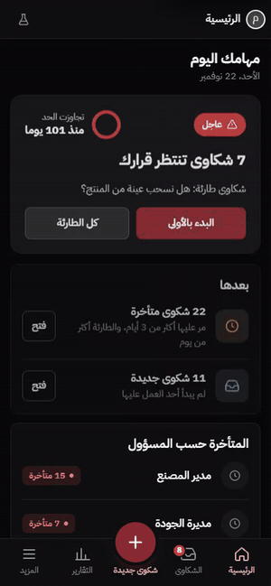</a>

للتجربة: افتح النسخة التجريبية واختر دورا من شاشة الدخول: المالك، مديرة الجودة، مدير المصنع، أو خدمة العملاء. كل دور له شاشات مختلفة. كل الأسماء والأرقام والطلبات في النسخة التجريبية وهمية.

تطوير: **محمد التونسي**، [LinkedIn](https://www.linkedin.com/in/mohammed-altounsi/)

---

## الشاشات

<table>
<tr>
<td align="center">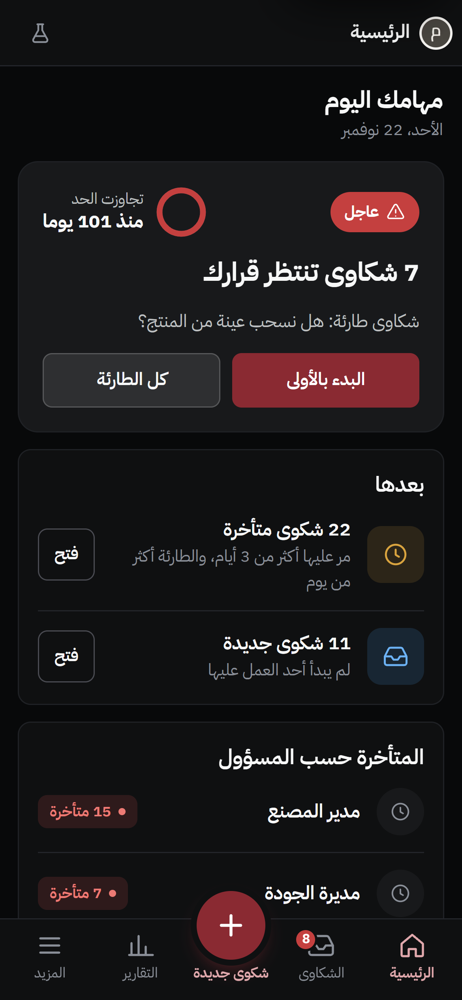 الرئيسية</td>
<td align="center">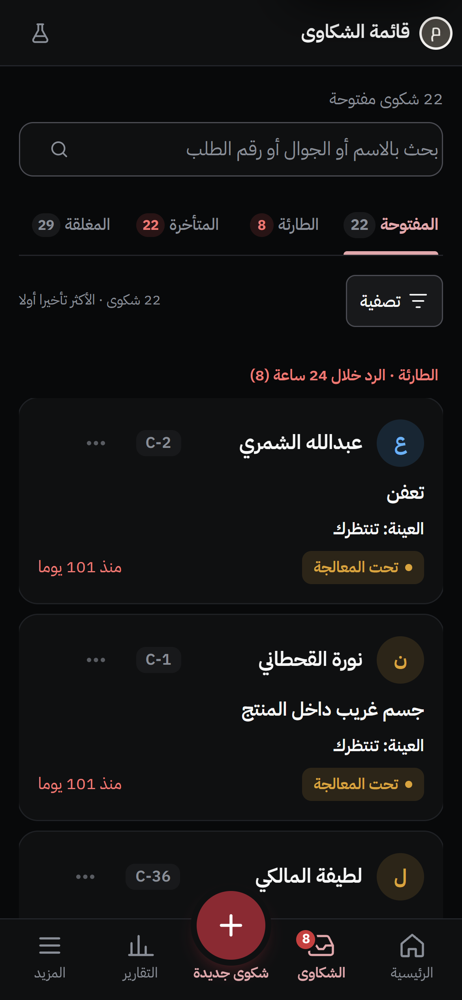 الشكاوى</td>
<td align="center">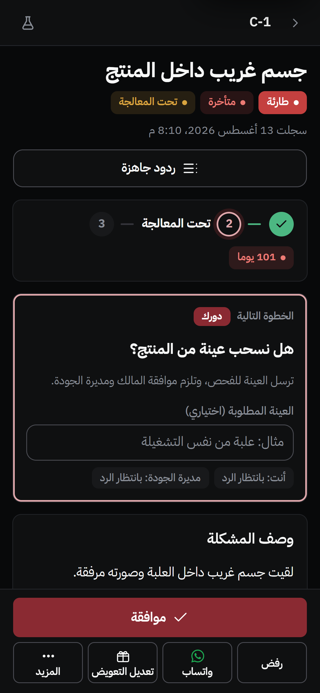 صفحة الشكوى</td>
<td align="center">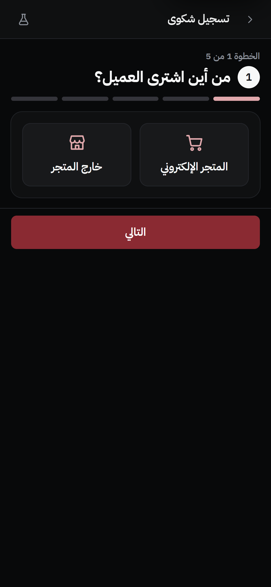 شكوى جديدة</td>
</tr>
<tr>
<td align="center">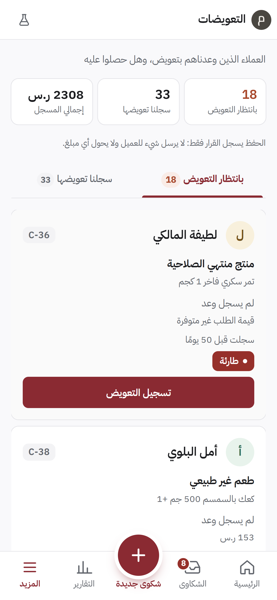 التعويضات</td>
<td align="center">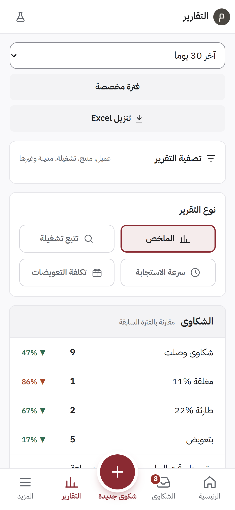 التقارير</td>
<td align="center">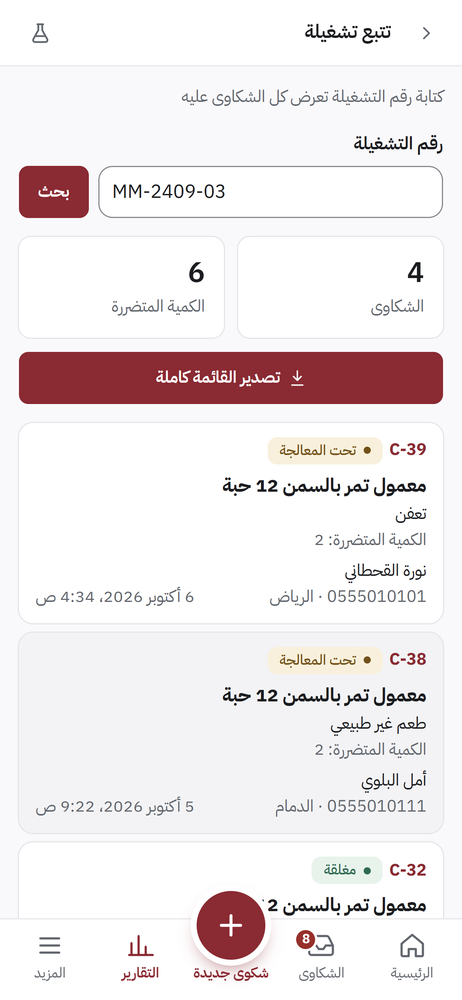 تتبع تشغيلة</td>
<td align="center">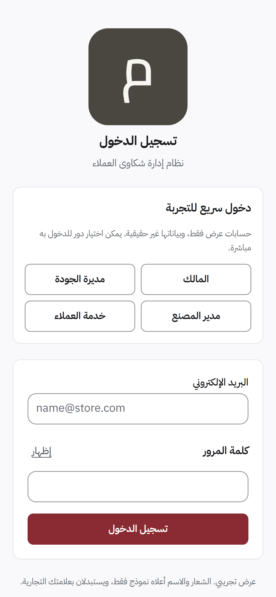 تسجيل الدخول</td>
</tr>
</table>

على الكمبيوتر:

<table>
<tr>
<td align="center">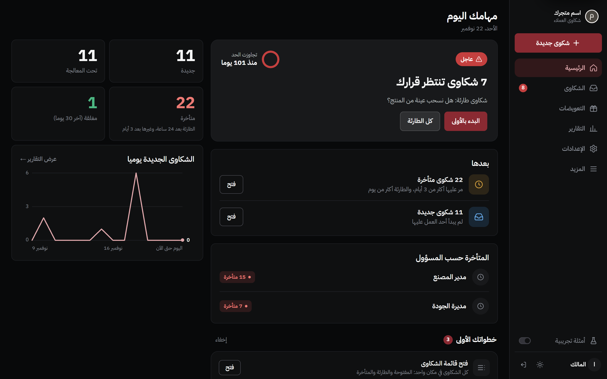 الرئيسية، الوضع الليلي</td>
<td align="center">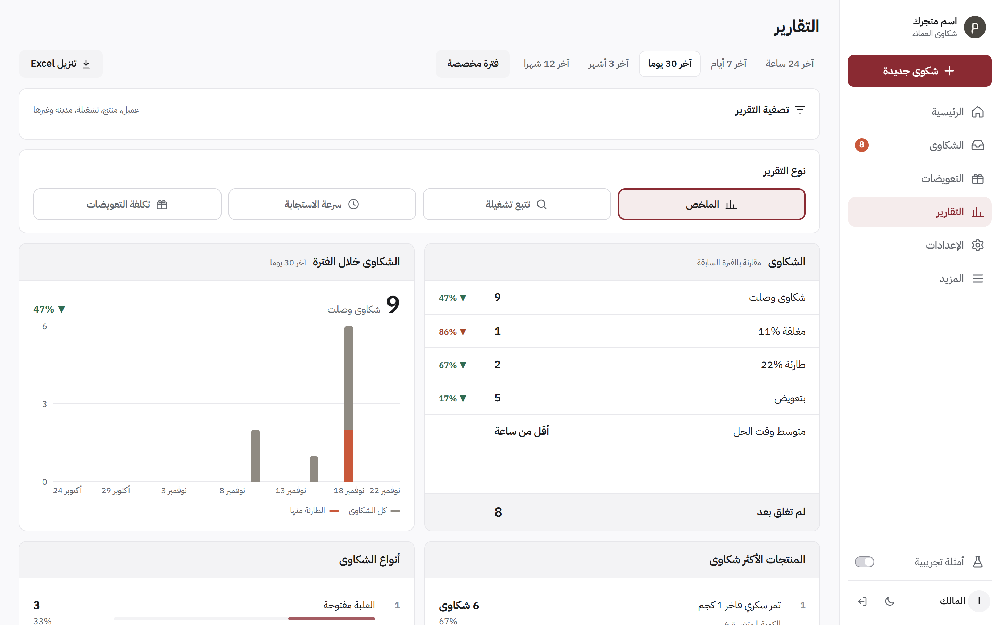 التقارير، الوضع النهاري</td>
</tr>
<tr>
<td align="center">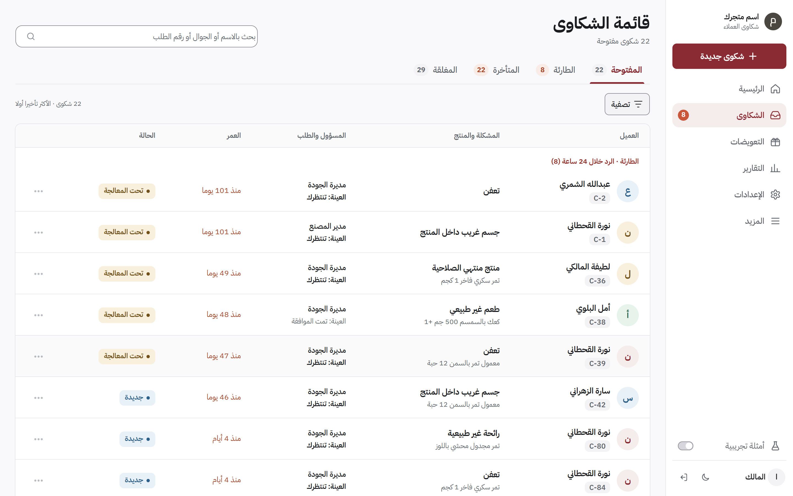 قائمة الشكاوى</td>
<td align="center">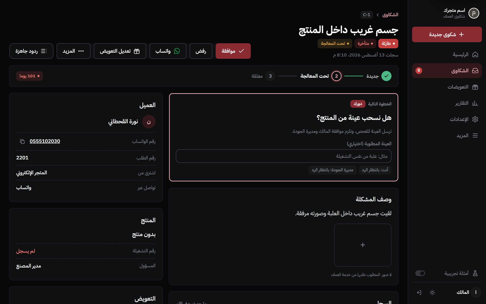 صفحة الشكوى</td>
</tr>
</table>

باقي الشاشات في مجلد [`screenshots/`](screenshots): كل شاشة بالوضع الليلي والنهاري، على الجوال والكمبيوتر.

## الجديد في النسخة الثانية

- **الرئيسية** تفتح على أهم قرار ينتظرك وزر واحد للبدء فيه، وبعده الخطوات التالية والشكاوى المتأخرة عند كل مسؤول.
- **قائمة الشكاوى** جدول واحد بتبويبات: المفتوحة، الطارئة، المتأخرة، والمغلقة، وجنب كل تبويب عدد شكاواه. وعلى الجوال كل شكوى في بطاقة.
- **صفحة الشكوى** فيها المرحلة (جديدة، تحت المعالجة، مغلقة)، وخطوتك التالية، والسجل، وبيانات العميل والمنتج. وعلى الجوال الأزرار ثابتة أسفل الشاشة.
- **التعويضات** بنفس جدول قائمة الشكاوى.
- **التقارير** على شكل صفحة تقارير سلة: تختار الفترة ونوع التقرير، وتقارن بالفترة اللي قبلها، ويطلع لك تنبيه لما توصل 3 شكاوى أو أكثر على نفس تشغيلة الإنتاج.
- **الوضع الليلي** برمادي قريب من الأسود على طريقة Linear، ولمسات أحمر هادئ.

## المزايا

### تسجيل الشكوى
- البحث بجوال العميل أو رقم الطلب أو الإيميل، وبيانات الطلب من سلة تنعبى تلقائيا.
- الشكوى الوحدة تشمل أكثر من منتج، ولكل منتج مشاكله ورقم تشغيلته.
- إرفاق صور وفيديو ورسائل صوتية من الجوال.
- شكاوى الفروع والقنوات الثانية تتسجل بدون طلب.

### التوجيه والمهل
- كل شكوى تروح لفريق الجودة أو للمصنع حسب نوع المشكلة.
- الشكوى الطارئة تعتبر متأخرة بعد 24 ساعة، وغيرها بعد 3 أيام.
- سحب عينة المنتج يحتاج موافقة شخصين، وسجل الموافقة ما ينعدل.

### التقارير
- فترات من آخر 24 ساعة إلى آخر 12 شهر، أو فترة تحددها.
- التوزيع حسب المنتج والمشكلة والمدينة والتشغيلة، مع أسباب إغلاق الشكاوى.
- تتبع تشغيلة: كل الشكاوى على تشغيلة إنتاج وحدة، مع الكمية المتضررة.
- سرعة الرد لكل فريق، وتكلفة التعويضات، وتصدير Excel.

### غير ذلك
- رسالة واتساب جاهزة للعميل فيها اسم المنتج ورقم الطلب.
- ردود جاهزة للأسئلة المتكررة.
- عمليات الدخول تتسجل، والحساب يتوقف مؤقتا بعد تكرار كلمة مرور غلط.
- الطلبات توصل من سلة عبر الـ Webhooks، ومهمة ليلية تسحب أي طلب فات.
- مصمم للجوال أولا: الأزرار ما تقل عن 44 بكسل، وما فيه تمرير جانبي، والتنقل بلوحة المفاتيح واضح.

## التقنيات

Next.js 16، React 19، TypeScript، Supabase (Postgres، Auth، Storage)، Tailwind CSS 4، Vercel.

## الأمان

- بيانات كل متجر مفصولة بخاصية Row-Level Security في Postgres.
- صور العملاء ومقاطعهم في تخزين خاص، وتنفتح بروابط تنتهي صلاحيتها.
- مفاتيح الوصول لسلة مشفرة في قاعدة البيانات.
- سياسة أمان المحتوى و`X-Frame-Options: DENY` تمنع المواقع الثانية من تضمين التطبيق، والاتصال مشفر دائما عبر HSTS.

---

الشيفرة المصدرية خاصة، وهذا المستودع فيه لقطات شاشة وفيديو قصير. لجولة في التطبيق أو نسخة تجريبية لمتجرك، راسلني على [LinkedIn](https://www.linkedin.com/in/mohammed-altounsi/).

