

**English** · [العربية](README.ar.md)

# Complaints Management System v2

A web app for logging and handling customer complaints for online stores on Salla. Arabic, right to left. Version 2 has a redesigned interface.

[Live demo](https://complaints-demo-v2.vercel.app) · [Screen tour](media/tour.mp4)

<a href="media/tour.mp4">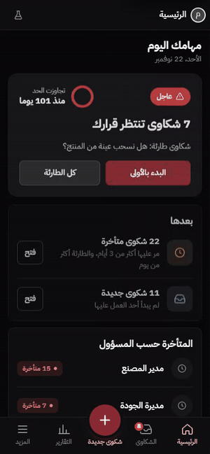</a>

To try it, open the demo and pick a role on the login screen: owner, quality manager, factory manager or customer service. Each role sees different screens. All names, phone numbers and orders in the demo are made up.

Built by **Mohammed Altounsi**, [LinkedIn](https://www.linkedin.com/in/mohammed-altounsi/).

---

## Screens

<table>
<tr>
<td align="center">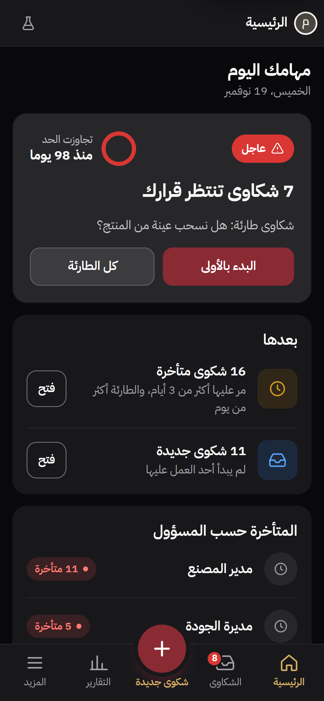 Home</td>
<td align="center">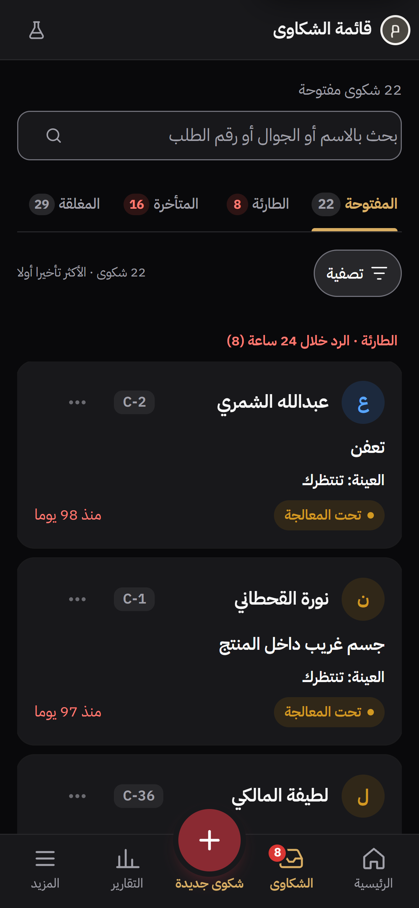 Complaints</td>
<td align="center">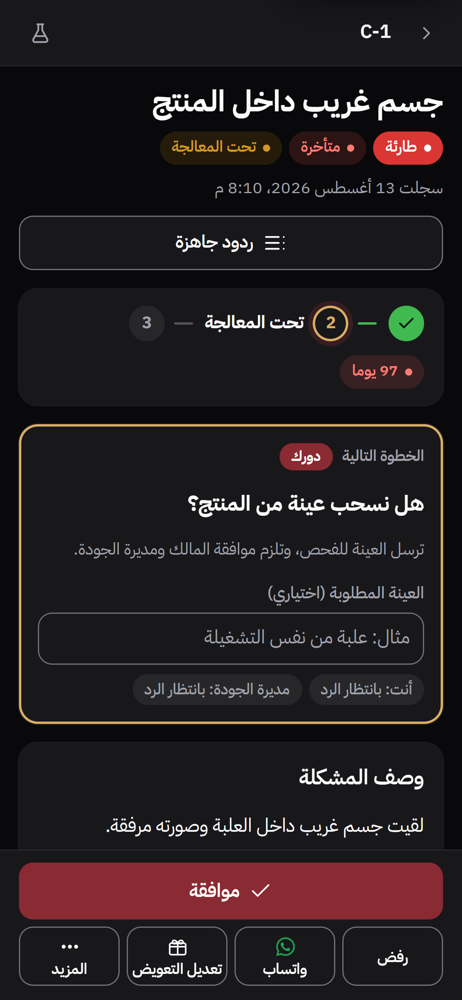 One complaint</td>
<td align="center">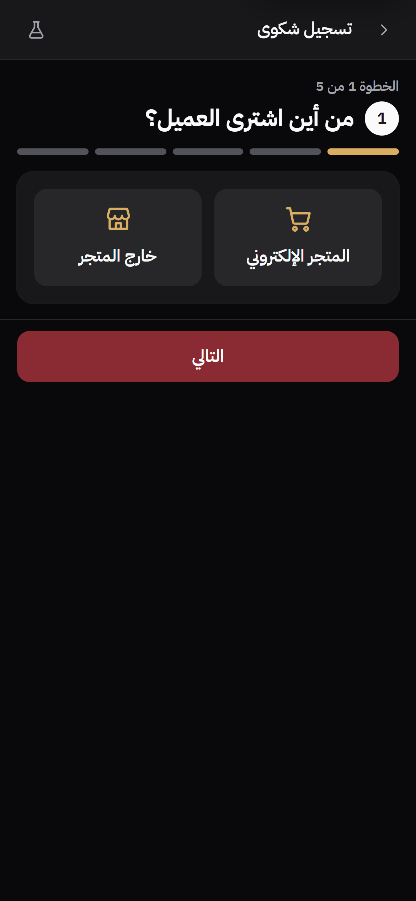 New complaint</td>
</tr>
<tr>
<td align="center">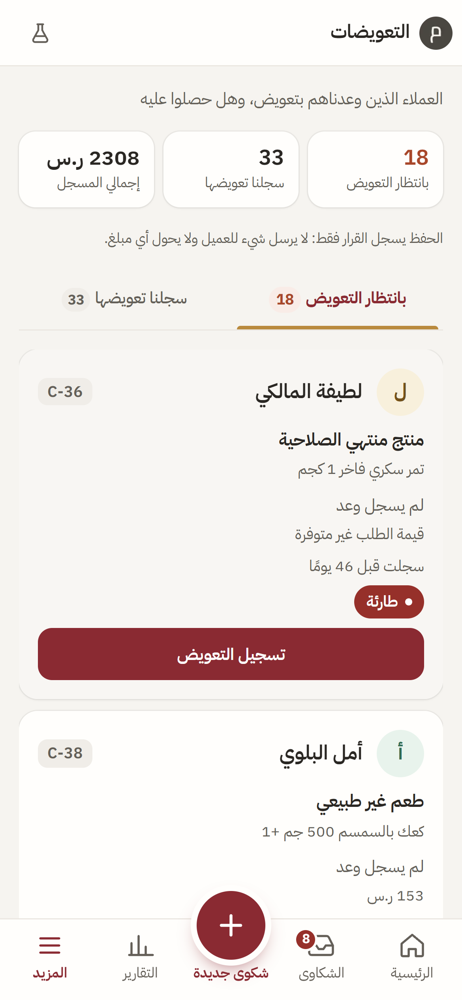 Compensation</td>
<td align="center">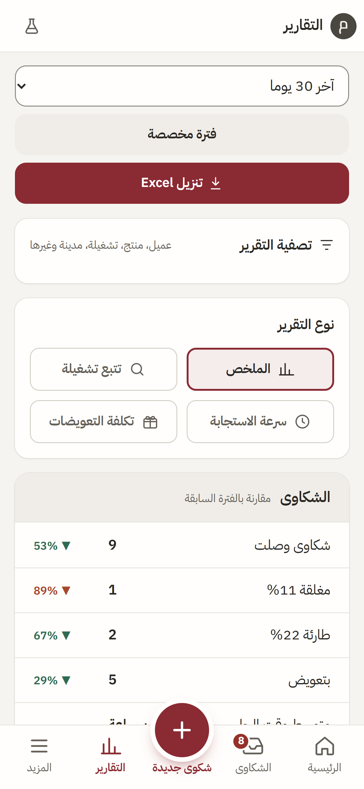 Reports</td>
<td align="center">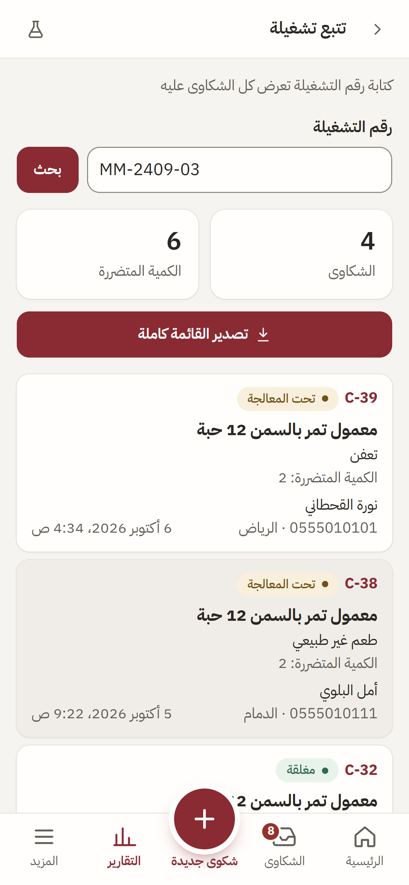 Batch tracking</td>
<td align="center">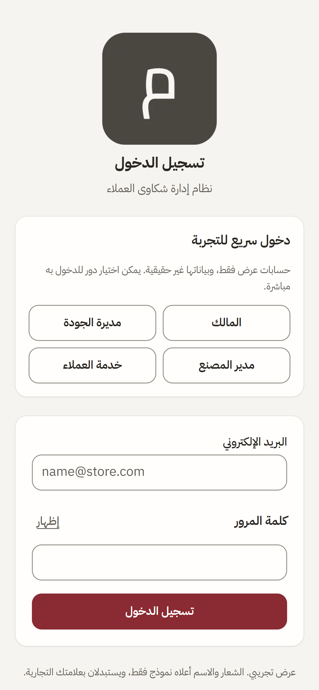 Login</td>
</tr>
</table>

On a computer:

<table>
<tr>
<td align="center">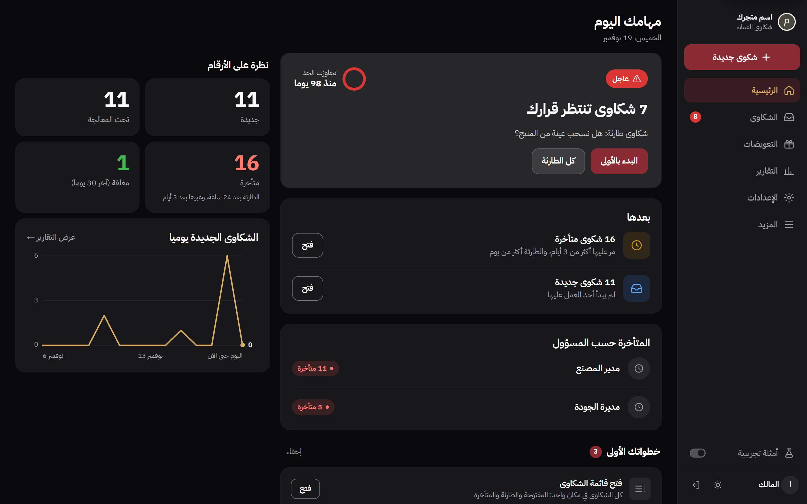 Home, dark mode</td>
<td align="center">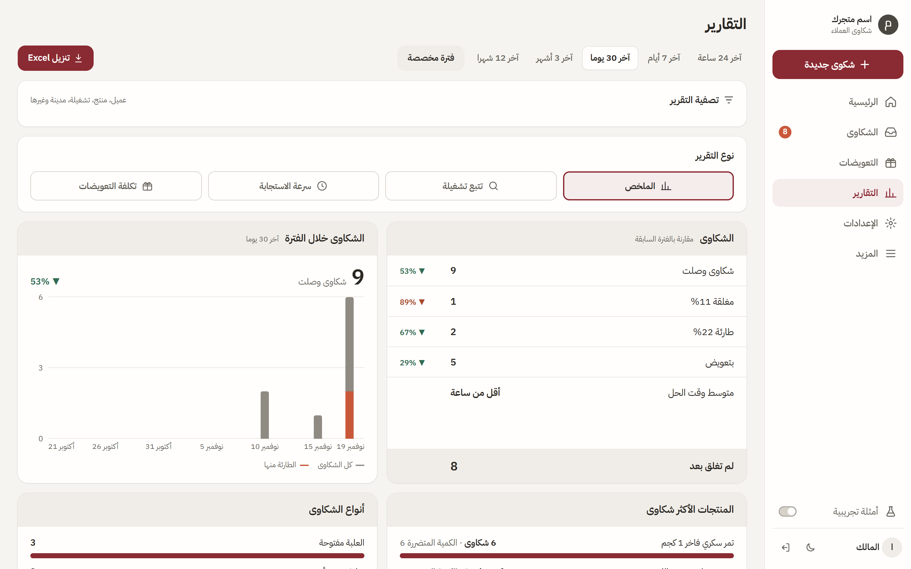 Reports, light mode</td>
</tr>
<tr>
<td align="center">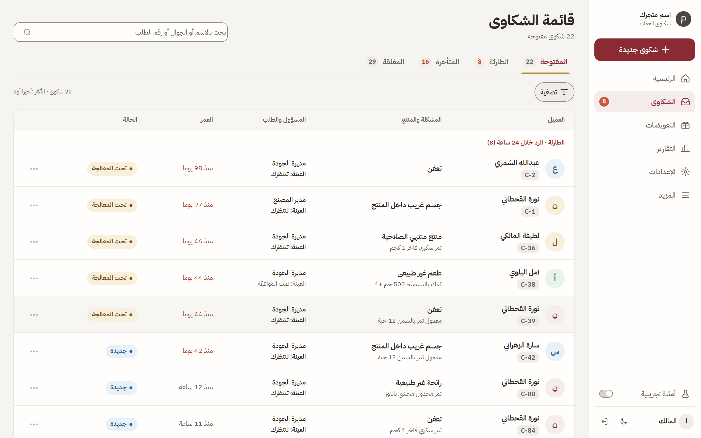 Complaints list</td>
<td align="center">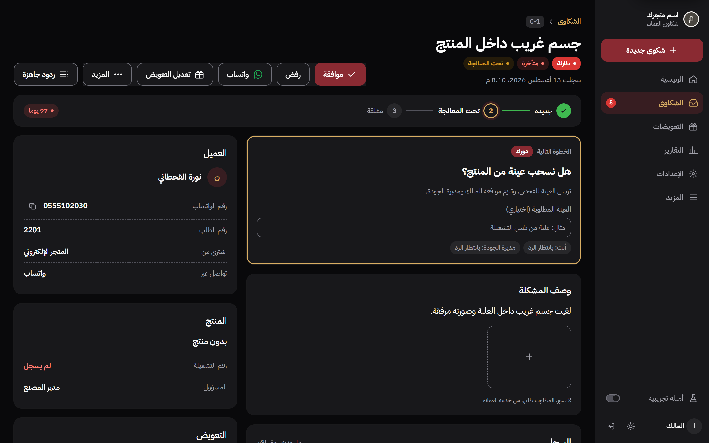 One complaint</td>
</tr>
</table>

More in [`screenshots/`](screenshots): every screen in light and dark mode, on a phone and on a computer.

## What's new in v2

- **Home** opens on the most urgent decision, with one button to start it, then the next things to do and the late complaints for each manager.
- **Complaints list** is one table with tabs for open, emergency, late and closed, each with its count. On a phone every row becomes a card.
- **Complaint page** shows the stage (new, in progress, closed), the next step for you, the log, and the customer and product. On a phone the actions sit in a bar at the bottom.
- **Compensation** uses the same table as the complaints list.
- **Reports** follow the layout of Salla's reports page: choose the period and the report type, compare with the previous period, and get an alert when 3 or more complaints point at the same production batch.
- **Dark mode** uses the Tailwind Zinc greys.

## Features

### Logging a complaint
- Search by the customer's phone number, order number or email. The Salla order fills in automatically.
- One complaint can cover several products. Each product gets its own issues and batch number.
- Attach photos, videos and voice notes from the phone.
- Complaints from a branch or another channel are logged without an order.

### Routing and deadlines
- Each complaint is assigned to the quality team or the factory based on the issue type.
- An emergency is late after 24 hours, any other complaint after 3 days.
- Collecting a product sample needs approval from two people. The approval record can't be edited.

### Reports
- Periods from the last 24 hours to the last 12 months, or a custom range.
- Breakdowns by product, issue, city and batch, with the reasons complaints were closed.
- Batch tracking: every complaint linked to one production batch, with the quantity affected.
- Response times per team, compensation cost, and Excel export.

### Other
- A ready WhatsApp message to the customer, with the product name and order number.
- Saved replies for common answers.
- Sign-ins are logged. An account is paused after repeated wrong passwords.
- Orders arrive from Salla through webhooks, and a nightly job pulls any that were missed.
- Built for phones first: tap targets of at least 44 px, no sideways scrolling, and a visible keyboard focus.

## Tech

Next.js 16, React 19, TypeScript, Supabase (Postgres, Auth, Storage), Tailwind CSS 4, Vercel.

## Security

- Each store's data is separated with Postgres row-level security.
- Customer photos and videos are in private storage and open through links that expire.
- Salla access tokens are encrypted in the database.
- A content security policy and `X-Frame-Options: DENY` stop other sites from embedding the app. HTTPS is enforced with HSTS.

---

The source code is private. This repository holds screenshots and a short screen tour. For a walkthrough or a demo for your store, message me on [LinkedIn](https://www.linkedin.com/in/mohammed-altounsi/).
